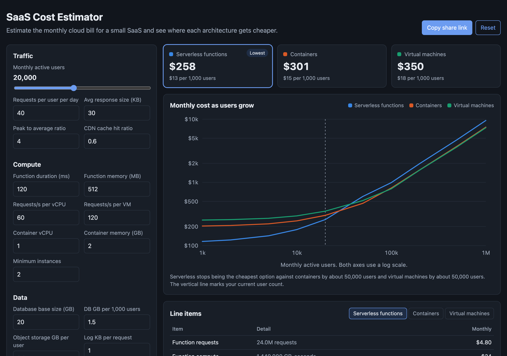

# SaaS Cost Estimator

A browser tool that estimates the monthly cloud bill for a small SaaS product and compares three ways to run it: serverless functions, containers, and virtual machines. Move the user slider and watch where each option becomes the cheapest.



## Why

"Serverless or containers?" usually gets answered by habit. The real answer depends on traffic shape, payload size, and how the database is sized. Serverless is cheap at low volume because you pay per request. Containers and VMs have a fixed floor but a lower marginal cost, so they win once traffic is steady and high.

This tool makes that tradeoff concrete. It turns a handful of product assumptions into line items an engineer or a finance partner can check by hand.

## What it models

| Area | How it is estimated |
|---|---|
| Traffic | Users x requests per user per day x 30. Peak rate = average rate x peak ratio. |
| Serverless | Per-request fee, GB-seconds of compute, and an API gateway fee. |
| Containers | Tasks sized to peak traffic with a minimum count, billed per vCPU-hour and GB-hour, plus a load balancer. |
| VMs | Instances sized to peak traffic with a minimum count, plus a load balancer. |
| Database | Smallest managed tier that fits peak connections. Serverless gets more connection headroom. Optional multi-AZ doubles it. |
| Storage | Object storage per user and database storage that grows with users. |
| Network | CDN offload by hit ratio, then origin egress after a free tier. |
| Observability | Log volume per request. |

Prices are rounded on-demand list prices for one US region. They are assumptions for comparison, not a quote. All of them sit in one object, `DEFAULT_PRICES` in `src/cost.js`, so you can swap in your own.

## Features

- Three side-by-side totals with cost per 1,000 users.
- A log-scale chart of total cost from 1,000 to 1,000,000 users, with a hover readout and the point where serverless stops being cheapest.
- An itemized table for each architecture, with the quantity behind each line.
- A warning when peak database connections outgrow the largest tier.
- Inputs live in the URL, so "Copy share link" captures the whole estimate.

## Run it

It is a static site with no build step and no dependencies.

- **GitHub Pages:** enable Pages for the repo and serve from the root of the default branch.
- **Locally:** ES modules need a web server, so `file://` will not work. From this folder run:

```bash
python3 -m http.server 8000
```

Then open http://localhost:8000.

## Tests

The cost model in `src/cost.js` has no DOM access, so it runs under Node's built-in test runner. Node 18 or newer is enough, with no packages to install. The tests check line items against hand math, the free tier, minimum instance counts, database tier selection, the crossover search, and the URL round trip.

```bash
npm test
```

## Limits

This is a first-pass sizing tool. It ignores reserved and savings-plan discounts, free tiers other than egress, cold starts, cross-AZ traffic, and staff time. Staff time is often the largest cost of all, and it usually favors the managed options.

## License

MIT. See [LICENSE](LICENSE).
